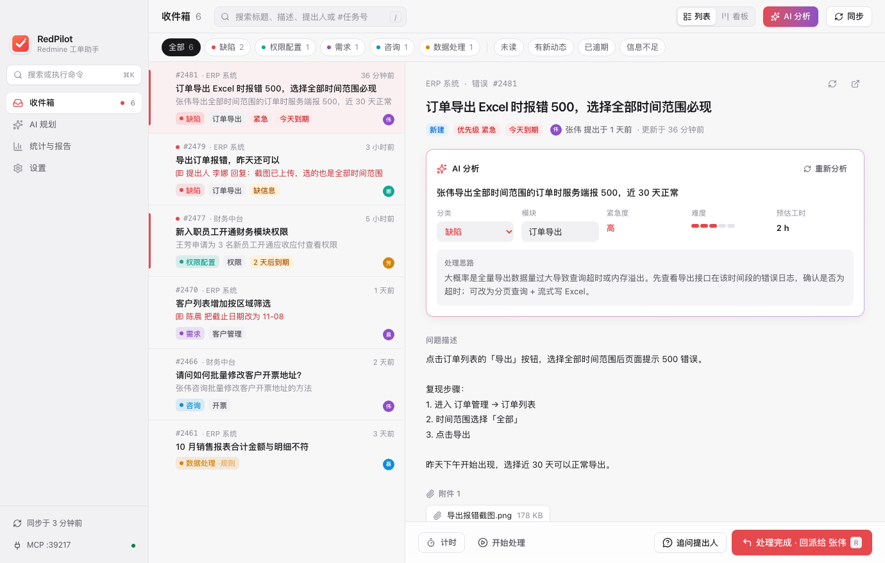
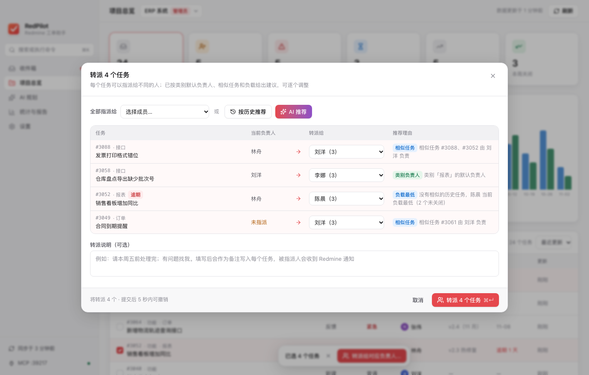
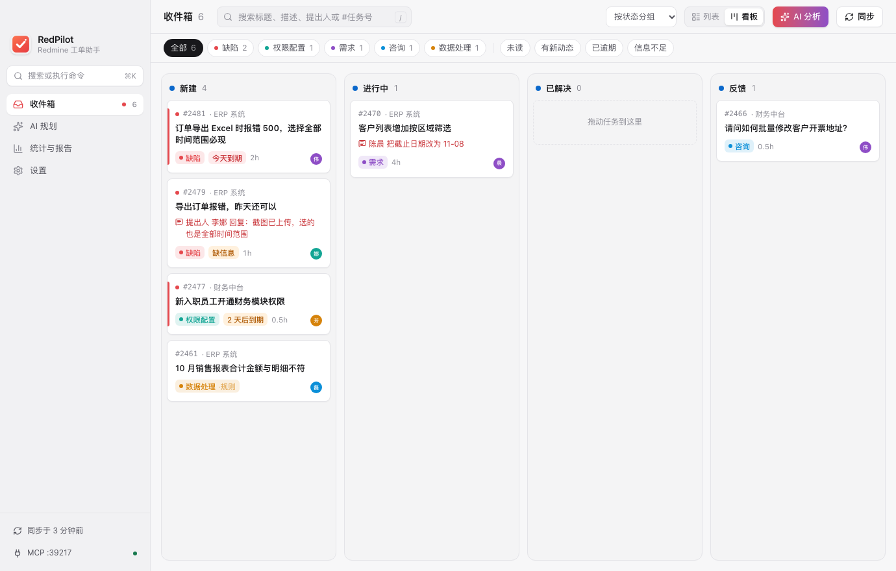
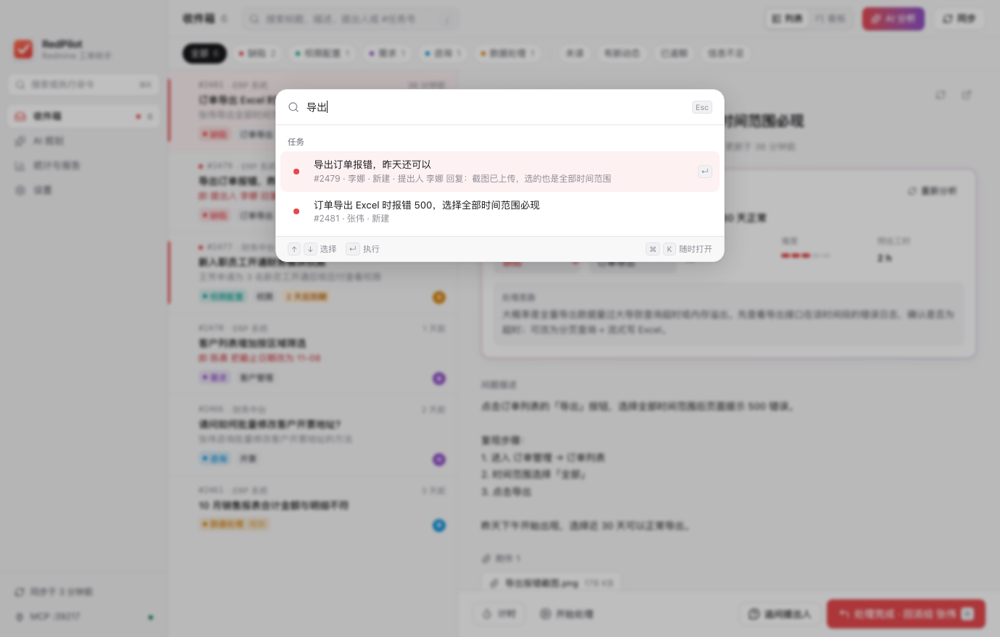
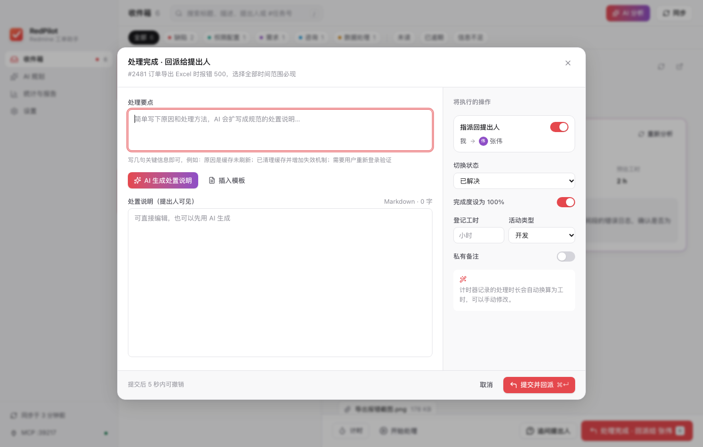
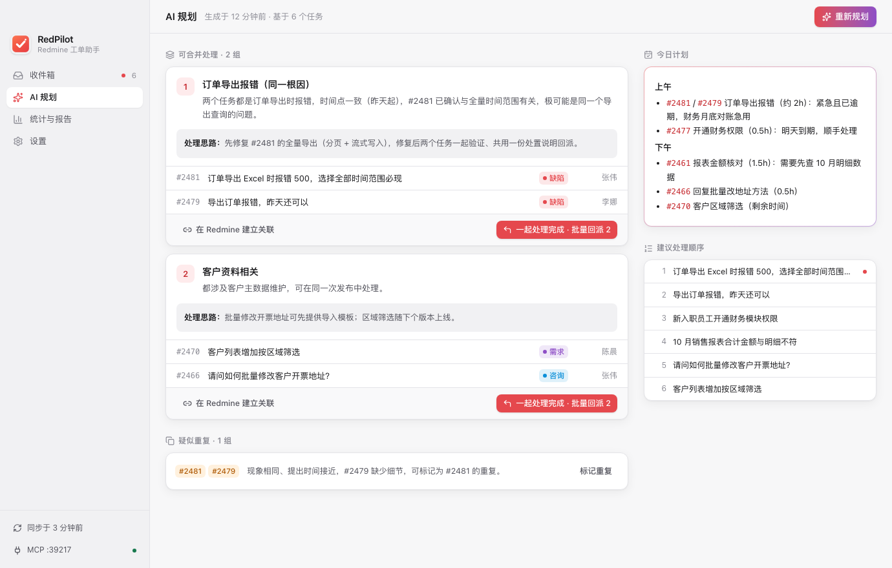
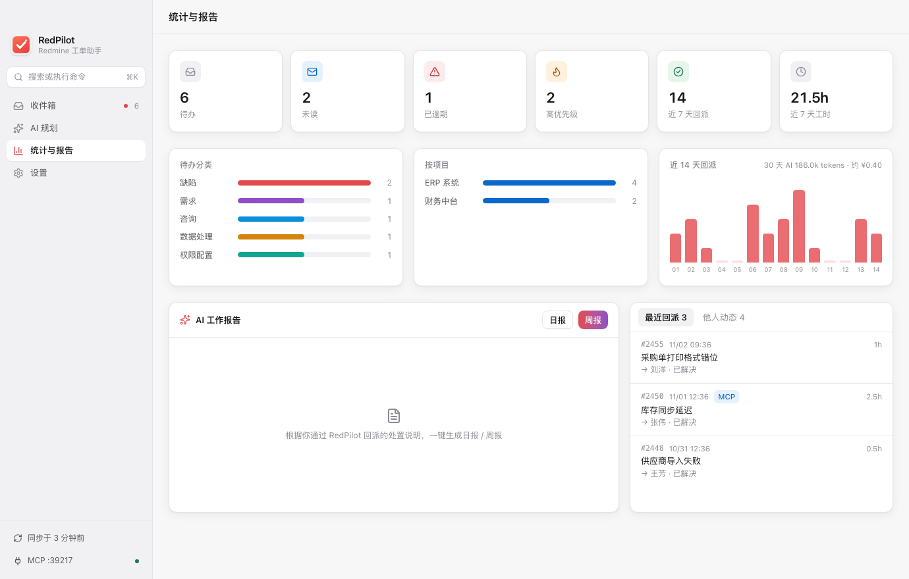
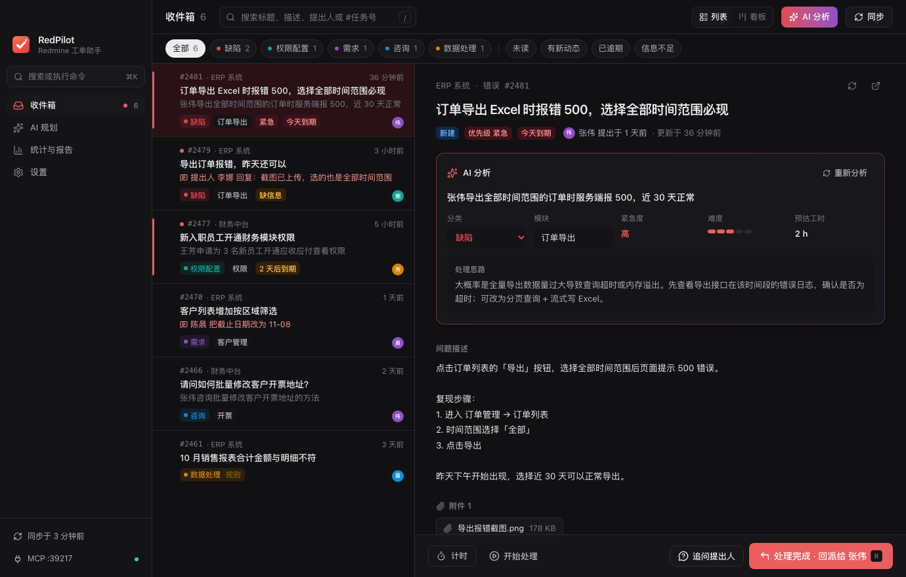
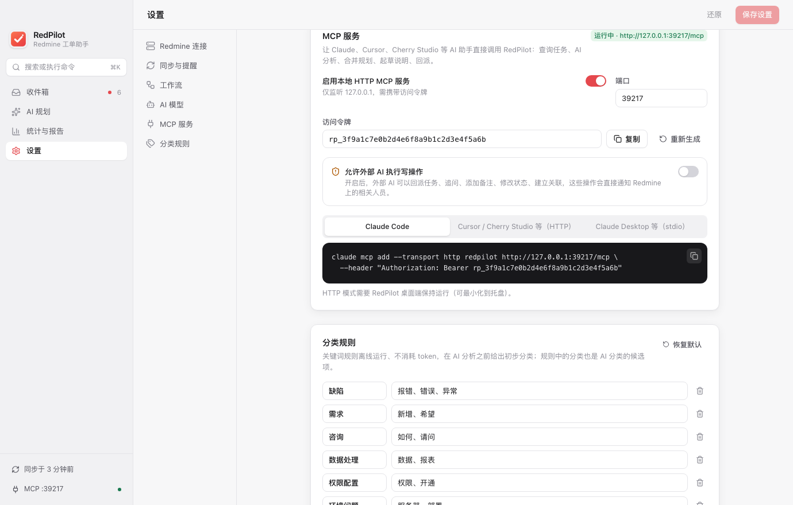

<div align="center">


# RedPilot

**Redmine 智能工单助手**

自动拉取任务 · AI 分类与合并规划 · 一键回派提出人 · 原生 MCP 服务


</div>

---

RedPilot 是给 Redmine 问题处理人用的桌面效率工具。它在后台拉取指派给你的任务，用 DeepSeek 做分类和分析，找出可以合并处理的任务。处理完后，写几句要点，点一下就能生成规范的处置说明，并把任务回派给提出人。

它还内置了 MCP 服务，Claude、Cursor、Cherry Studio 等 AI 助手可以直接查询、分析和处理你的工单。

<p align="center">
  
</p>

## ✨ 功能

### 📥 自动同步
- 同步范围：指派给我、我关注的、Redmine 中已保存的查询，可以限定项目
- 后台定时同步，关闭窗口后在托盘中继续运行
- 新任务弹出系统通知，菜单栏显示未读数
- **动态提醒**：提出人回复、任务被转回给你、被调为高优先级、今天或明天到期时提醒；你自己的操作不会提醒
- 开机自动启动，在托盘中静默运行
- 本地 SQLite 缓存，打开快，离线也能查看

### 🗂️ 工作台
- 列表和**看板**两种视图；列表默认按提出时间倒序，可按月份或项目分组，可切换按更新时间、优先级、截止日期排序
- 按项目筛选；看板可按状态、分类、项目或紧急度分组
- 描述和沟通记录中的**图片直接显示**（附件需要登录才能访问，由 RedPilot 带 API Key 下载并缓存），点击可放大
- 拖动卡片即可修改 Redmine 状态，拖到底部回派区直接回派
- **⌘K / Ctrl+K 命令面板**：搜索任务、跳转页面、执行同步、分析、规划、日报和周报

### 🧭 项目总览（项目管理员视角）
- 选择项目查看全部未关闭任务（不限于指派给自己的），自己担任管理角色的项目排在前面
- 进度：未指派、逾期、14 天未更新、本周新增与关闭；各版本完成进度；近 8 周新增与关闭趋势
- 成员负载：每人负责多少任务、其中逾期多少，点击即可筛选
- **多选后一键转派**：每个任务按类别默认负责人、相似任务现在由谁负责、当前负载推荐负责人，也可以让 AI 分配；可逐个调整或全部指派给一个人，附带统一说明

<p align="center">
  
</p>

### 🧠 AI 分析与分类
- 关键词规则离线预分类，不消耗 token
- DeepSeek 给出分类、模块、紧急度、难度、预估工时、一句话摘要和处理思路
- **信息不足检测**：自动写好追问话术，一键发给提出人（状态改为“反馈”）
- 人工修正的分类会作为样例反馈给 AI，用得越多分得越准
- 可以为分类、规划、处置说明、报告分别追加团队自定义提示词

### 🧩 合并规划
- 先用本地 TF-IDF 预聚类，再由 AI 判断哪些任务**可以一起做**，并说明理由和处理思路
- 识别疑似重复的任务，给出建议处理顺序和今日工作计划
- 一键在 Redmine 上建立任务关联

### ↩️ 一键回派
- 写几句处理要点，由 **AI 扩写成处置说明**（问题原因 / 处理方法 / 处理结果 / 影响范围 / 验证建议）
- 点一下同时完成：写入说明、切换状态、**指派回提出人**、完成度 100%、登记工时
- 指派对象默认是提出人，也可以转给项目里的其他成员或组，或保持不变（只写备注）
- **附件**：粘贴截图会自动作为附件插入说明，也可以选择或拖入文件；批量回派时分别上传到每个任务
- 合并处理的任务可以批量回派；提交后 5 秒内可以撤销
- 能识别提出人不可指派、提出人是自己、工作流不允许该状态等情况，给出明确提示

### 📊 统计与报告
- 待办、逾期、高优先级、回派趋势、工时、AI 用量
- AI 一键生成日报、周报；按单价估算 AI 费用

### 🔐 安全与隐私
- API Key 存在系统钥匙串（macOS Keychain / Windows 凭据管理器）
- 发送给 AI 之前自动脱敏：手机号、身份证、邮箱、IP、密码、密钥串
- 涉密项目可以设置为不发送给 AI
- MCP 写操作默认关闭

<table>
  <tr>
    <td></td>
    <td></td>
  </tr>
  <tr>
    <td align="center">看板：拖动改状态、拖到回派区</td>
    <td align="center">⌘K 命令面板</td>
  </tr>
  <tr>
    <td></td>
    <td></td>
  </tr>
  <tr>
    <td align="center">一键回派：AI 说明 + 粘贴截图</td>
    <td align="center">AI 合并规划</td>
  </tr>
  <tr>
    <td></td>
    <td></td>
  </tr>
  <tr>
    <td align="center">统计与报告</td>
    <td align="center">暗色模式（跟随系统）</td>
  </tr>
</table>

## 🤖 MCP：让其他 AI 调用 RedPilot

RedPilot 提供两种 MCP 接入方式：

| 方式 | 地址 / 命令 | 说明 |
|---|---|---|
| Streamable HTTP | `http://127.0.0.1:39217/mcp` | 桌面端运行时可用，仅监听本机，需要 Bearer 令牌 |
| stdio | `redpilot --mcp-stdio` | 由客户端直接拉起，不要求桌面端在运行 |

在 **设置 → MCP 服务** 中可以一键复制下面的配置。

<details>
<summary><b>Claude Code</b></summary>

```bash
claude mcp add --transport http redpilot http://127.0.0.1:39217/mcp \
  --header "Authorization: Bearer <令牌>"
```
</details>

<details>
<summary><b>Cursor / Cherry Studio / Windsurf 等（HTTP）</b></summary>

```json
{
  "mcpServers": {
    "redpilot": {
      "url": "http://127.0.0.1:39217/mcp",
      "headers": { "Authorization": "Bearer <令牌>" }
    }
  }
}
```
</details>

<details>
<summary><b>Claude Desktop 等（stdio）</b></summary>

```json
{
  "mcpServers": {
    "redpilot": {
      "command": "/Applications/RedPilot.app/Contents/MacOS/redpilot",
      "args": ["--mcp-stdio"]
    }
  }
}
```
</details>

**工具列表**

| 类型 | 工具 |
|---|---|
| 查询与分析 | `get_overview` · `sync_issues` · `list_issues` · `get_recent_changes` · `get_issue` · `analyze_issues` · `suggest_batches` · `get_latest_plan` · `find_similar_issues` · `get_workflow_options` · `list_assignees` · `draft_resolution_note` · `set_classification` · `work_report` |
| 项目总览 | `list_my_projects` · `get_project_overview` · `suggest_assignments` |
| 写操作（需授权） | `resolve_issue`（可带附件） · `batch_resolve` · `bulk_assign` · `request_more_info` · `start_progress` · `update_status` · `add_note` · `link_issues` |

写操作会直接修改 Redmine 并通知相关人员，需要在设置中手动开启“允许外部 AI 执行写操作”。通过 MCP 上传附件时，隐藏目录和 RedPilot 数据目录中的文件会被拒绝。

<p align="center">
  
</p>

## 🚀 快速开始

### 下载安装

在 [Releases](https://github.com/willsshan/redpilot/releases) 页面下载最新版本：

| 系统 | 安装包 |
|---|---|
| macOS 11+（Apple 芯片与 Intel 通用） | `RedPilot_x.y.z_universal.dmg` |
| Windows 10 / 11 | `RedPilot_x.y.z_x64-setup.exe`（推荐）或 `.msi` |

安装包暂未签名：
- **macOS**：首次打开时右键点击应用 →“打开”；如果提示“已损坏”，在终端执行 `xattr -cr /Applications/RedPilot.app`
- **Windows**：出现 SmartScreen 提示时，点“更多信息”→“仍要运行”

### 前置条件
- Redmine 管理员已在“管理 → 配置 → API”中启用 **REST web service**
- 你的 Redmine API Key（在“我的账号”页面右侧查看）
- DeepSeek API Key（或其他 OpenAI 兼容的模型服务）

### 从源码运行

```bash
git clone https://github.com/willsshan/redpilot.git
cd redpilot
npm install
npm run tauri dev
```

首次打开后进入 **设置**：
1. 填写 Redmine 地址和 API Key，点击“测试连接”
2. 在“工作流”中选择“处理完成 / 开始处理 / 追问”三个状态
3. 填写 DeepSeek API Key，点击“测试 AI 连接”

### 打包

```bash
npm run tauri build
```

macOS 生成 `.app` / `.dmg`，Windows 生成 `.msi` / `.exe`。

推送 `v*` 标签（如 `git tag v0.2.0 && git push --tags`）后，GitHub Actions 会自动构建 macOS 通用版和 Windows 安装包，并创建草稿 Release。

**环境要求**：Rust 1.88+、Node.js 20+。Windows 还需要 [Visual Studio C++ 生成工具](https://visualstudio.microsoft.com/visual-cpp-build-tools/) 和 WebView2（Windows 10/11 一般已自带）。

## 🏗️ 架构

```
redpilot/
├── crates/redpilot-core/     # Rust 核心库（桌面端与 MCP 共用）
│   ├── redmine.rs            #   Redmine REST 客户端
│   ├── ai.rs                 #   OpenAI 兼容客户端（DeepSeek）
│   ├── analysis.rs           #   规则分类、TF-IDF 相似度、预聚类
│   ├── service.rs            #   同步、分析、规划、回派等业务逻辑
│   ├── mcp.rs                #   MCP 服务（HTTP + stdio）
│   ├── db.rs                 #   SQLite 本地缓存
│   ├── mask.rs               #   敏感信息脱敏
│   └── bin/redpilot-mcp.rs   #   独立 stdio MCP 可执行文件
├── src-tauri/                # Tauri 2 桌面壳：命令、托盘、后台同步、通知
├── src/                      # React + TypeScript + Tailwind CSS 界面
└── docs/                     # 产品功能清单、截图
```

| 层 | 技术 |
|---|---|
| 桌面框架 | Tauri 2（macOS WKWebView / Windows WebView2），安装包约 10MB |
| 后端 | Rust · tokio · reqwest · rusqlite · keyring · rmcp |
| 前端 | React 19 · TypeScript · Tailwind CSS 4 · lucide |
| AI | DeepSeek，兼容 Ollama、vLLM、私有化部署等 OpenAI 协议服务 |

数据目录：macOS 为 `~/Library/Application Support/RedPilot/`，Windows 为 `%APPDATA%\RedPilot\`（可用环境变量 `REDPILOT_HOME` 覆盖）。

## ⚙️ 配置说明

| 项 | 说明 |
|---|---|
| 代理 | 留空使用系统代理，本机和内网地址自动直连；填 `direct` 强制直连 |
| 自签名证书 | 内网 Redmine 使用自签名证书时，开启“忽略证书错误” |
| 文本格式 | 与 Redmine“设置 → 显示 → 文本格式”保持一致（Markdown / Textile） |
| 规划模型 | 可以单独为合并规划指定推理模型，例如 `deepseek-reasoner` |
| 本地模型 | 接口地址填 `http://localhost:11434/v1`（Ollama）；不支持 JSON 模式时请关闭该选项 |

## 🗺️ 路线图

- [x] 同步、AI 分析分类、合并规划、一键回派、批量回派、追问
- [x] 相似历史知识库、计时与工时、日报 / 周报
- [x] MCP 服务（HTTP + stdio）
- [x] 看板视图、⌘K 命令面板、回派附件、动态与到期提醒、开机自启（v0.2）
- [x] 项目总览：版本进度、成员负载、多选一键转派（v0.2）
- [ ] 多服务器 / 多账号
- [ ] 自动更新、安装包签名

完整清单见 [docs/产品功能清单.md](docs/产品功能清单.md)。

## 🧪 测试

```bash
cargo test -p redpilot-core   # 核心逻辑单元测试
npm run typecheck             # 前端类型检查
```

每次推送到 main 或提交 PR 时，CI 会在 Windows 上运行测试并打出安装包（在 Actions 页面的 Artifacts 中下载）。

## 🤝 参与贡献

欢迎提 [Issue](https://github.com/willsshan/redpilot/issues) 反馈问题或建议，也欢迎提交 PR。提交前请确认 `cargo test -p redpilot-core` 和 `npm run typecheck` 通过。

反馈问题时请附上 Redmine 版本和操作系统。请勿在 Issue 中粘贴 API Key 或内部系统地址、截图。

## 👤 作者

**jayton**

## 📄 许可证

[MIT](LICENSE) © 2026 jayton
